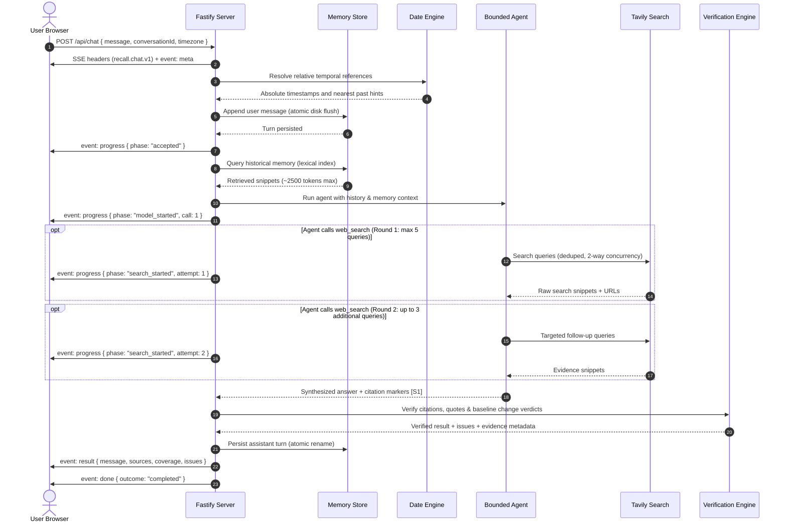

# Minimi Recall Agent — System Architecture & Design Rationale

**Single Source of Truth for Architectural Rationale**

*Minimi Hiring Challenge Submission | 20 November 2026*

---

## 1. Architectural Overview & Core Data Flow

Minimi Recall Agent is a high-performance, historically aware, evidence-grounded research assistant. It is built to answer quickly, maintain temporal continuity across sessions, and deterministically verify claims against authoritative web evidence.

The system adheres strictly to the hiring challenge mandate:
> *"Build the best chat agent you can with one tool, web search. It should answer fast, get things right, and remember what you asked and when."*

The architecture separates deterministic computational tasks (temporal date parsing, historical memory retrieval, budget tracking, quotation matching, and persistence) from generative tasks (reasoning, synthesis, and query formulation). The language model is provided **exactly one external tool: `web_search`**.

```
[Browser UI]
    |
    | HTTP POST /api/chat (JSON payload)
    v
[Fastify Server (Single Process)]
    |
    +---> [1. Temporal Resolution (chrono-node + IANA TZ)]
    |
    +---> [2. User Message Atomic Persistence (.data/conversations/)]
    |
    +---> [3. Deterministic Memory Retrieval (BM25 + TF-IDF)]
    |
    +---> [4. Bounded Agent Loop (Azure OpenAI v1 / AI SDK)]
             |
             | Invokes only one tool
             v
         [Tavily Search Coordinator] (Max 2 rounds, 5+3 budget)
             |
             v
    +---> [5. Deterministic Verification Engine]
             |-- 4 Verdicts
             |-- Verbatim Quote Normalization & Check
             |-- Vendor Grouping & Dimension Coverage
             v
    +---> [6. Assistant Turn Atomic Persistence]
    |
    v (Server-Sent Events: meta -> progress* -> result -> done)
[Browser UI (Clickable Citations & Sources Disclosure)]
```

---

## 2. Complete Request Lifecycle

The request lifecycle is governed by strict execution deadlines and abort signal propagation:



---

## 3. Frozen Technical Design Constraints

To maintain extreme focus and keep development feasible within four days at ₹0 out of pocket without requiring paid database services or cloud hosting, the technical architecture is explicitly frozen:
1. **Single External Tool:** The agent runtime exposes **only `web_search`**. All internal utilities—date calculation, conversation retrieval, citation validation, and disk persistence—are pure deterministic TypeScript functions.
2. **Single-Process Fastify Server:** A single Node.js process manages HTTP routing, SSE streaming, and local storage. No distributed clustering, Redis queues, or background worker pools are introduced.
3. **Plain HTML/CSS/JS Frontend:** The client is built in vanilla ES modules (`app.js`, `api.js`) and modern CSS. No React, Next.js, Webpack, Vite, or frontend build toolchains exist.
4. **No Vector Database:** Vector databases (Chroma, Pinecone, Qdrant) and embedding models add network hops, cold starts, memory overhead, and API costs. Minimi uses an embedded lexical search engine.
5. **₹0 Out-of-Pocket Local Architecture:** Built for standard developer machines using free-tier model/search allocations (Azure OpenAI / OpenAI free tier and Tavily free tier) and zero-cost offline test suites. Live provider requests consume user-configured API quotas.

---

## 4. Memory Architecture & Temporal Reasoning

### 4.1 Per-Conversation JSON Storage
- Conversations reside in `<project>/.data/conversations/<conversationId>.json`.
- Each record stores complete turns with message IDs, roles (`user`, `assistant`), content strings, UTC ISO timestamps, and detected timezones.
- **Atomic File Writing:** Writes flow through a per-conversation promise chain. The serializer writes to a unique temporary file (`.tmp-<uuid>`) and executes an atomic rename (`fs.rename`), preventing partial writes or torn reads during power interruptions.
- **Server-Winning Merge:** When client-seeded historical messages are submitted via `POST /api/chat`, they are merged with on-disk records by message ID (or hash of role + timestamp + content). On conflict, **the server's copy strictly wins**.

### 4.2 Temporal Date Parsing
- Implemented with `chrono-node` configured with the client's IANA timezone (default `Asia/Kolkata`).
- **Weekday Calculation:** "Last Tuesday" resolves to the most recent Tuesday strictly prior to the current local date.
- **Yearless Date Calculation:** Date expressions lacking a year (e.g., "3 November") resolve to the most recent past occurrence, preventing future-date hallucination for historical inquiries.
- **Context Injection:** The prompt context provides the model with the current local time, current UTC time, and resolved temporal interval hints.

---

## 5. Verification Engine & Quotation Integrity

### 5.1 The Four Verification Verdicts
When answering comparative questions about changes across time, the model is constrained to four explicit verdicts:
1. **`Confirmed change`:** An authoritative historical baseline exists, and fresh authoritative evidence confirms a factual difference. Requires a short verbatim quotation citing the source (`[S1]`).
2. **`No confirmed change`:** Authoritative baseline matches current authoritative evidence.
3. **`Cannot verify`:** Baseline is missing or unverified, current search evidence is ambiguous, or sources do not meet domain authority requirements.
4. **`Not comparable`:** The comparison mixes mismatched tiers, currencies, or specifications.

### 5.2 Verbatim Quotation Verification
For any `Confirmed change` verdict, the engine validates the accompanying quote against the retrieved source snippet text sent to the model:
- Normalizes Unicode punctuation, typographic quotes, case, and whitespace.
- If the cited quote does not appear verbatim in the source text, a quotation mismatch issue is recorded and visually flagged in the client UI.

### 5.3 Product Coverage & Multi-Vendor Grouping
For multi-entity verifications (such as five CRM platforms):
- Shortlisted candidates aggregate by vendor entity.
- The report guarantees that every requested entity appears in the output at the product level.
- If an entity lacks a reliable historical baseline, it is marked `Cannot verify`—never omitted and never fabricated.

---

## 6. Reliability, Safety & Budget Policies

| Policy | Value | Mechanism |
| :--- | :--- | :--- |
| **Request Deadline** | 25,000 ms | Node.js `AbortController` triggers SSE abort and socket cleanup |
| **Search Admission Cutoff** | 15,000 ms | New searches are rejected after 15s, reserving 10s for synthesis |
| **First Token Timeout** | 15,000 ms | Aborts stalled model requests; single retry with compressed context |
| **Max Search Rounds** | 2 rounds | Enforced by the search wrapper, independent of model prompt |
| **Search Query Limits** | 5 + 3 (max 8) | Round 1 admits &le; 5; Round 2 admits &le; 3; hard cap of 8 total |
| **Provider Concurrency** | 2 concurrent | Limits simultaneous outgoing HTTP connections to search providers |
| **Prompt Injection Defense** | Data boundary | Search results and past history are formatted as untrusted data blocks |

---

## 7. Architectural Trade-offs and Justifications

### 7.1 Lexical Memory vs. Vector Database
- *Decision:* Implemented an in-process lexical index (tokenization, stemming, TF-IDF, entity anchors) instead of a vector database (e.g., Pinecone, Chroma).
- *Rationale:* Vector embeddings require either local ONNX runtimes (~200MB+ download and high CPU/RAM usage) or third-party embedding API calls (introducing network latency and per-token costs). Lexical search achieves **P50 = 3.83 ms, P95 = 75.80 ms** retrieval latency, requires zero external daemons or vector indices, and provides 100% deterministic, explainable ranking.

### 7.2 Single-Process Fastify vs. Microservices / Agent Swarms
- *Decision:* Unified Fastify architecture instead of multi-service microservices or multi-agent swarms.
- *Rationale:* Microservice boundaries introduce serialization overhead, multiple points of network failure, and complicated deployment steps. A single Fastify server runs without a build step or additional service. Startup and memory usage depend on the machine; this audit did not measure RSS.

### 7.3 Plain HTML/CSS/JS vs. React / Next.js
- *Decision:* Native vanilla ES modules and clean CSS without frontend build tools.
- *Rationale:* Eliminates Webpack/Vite bundlers, `node_modules` bloat, hydration delays, and client-side framework overhead. The client loads instantly in any modern browser, handles streaming SSE effortlessly, and requires zero frontend compilation.

### 7.4 Deterministic Verification Engine vs. LLM-as-a-Judge
- *Decision:* Deterministic code-based quotation matching and verdict enforcement rather than a second LLM evaluation call.
- *Rationale:* LLM judges add 2–5 seconds of latency, double API token costs, and remain vulnerable to hallucinations. Deterministic verification guarantees strict string matching, consistent authority checking, and zero financial cost.

---

## 8. Measured Evaluation Metrics

### 8.1 Memory Performance Benchmarks (`npm run eval:memory`)
Measured on ten frozen recall scenarios with mocked model output; a separate regression exercises 500 conversations. These timings are local observations, not live-model accuracy or a 500-conversation latency benchmark. See `docs/recovery-memory-results.json`:
- **P50 Retrieval Latency:** **3.83 ms**
- **P95 Retrieval Latency:** **75.80 ms**
- **Recall Accuracy / Grounding:** **10 / 10 synthetic benchmark cases grounded**; this does not measure live-model accuracy.

### 8.2 Full Automated Regression Suite (`npm test`)
- **Total Test Files:** 33 files
- **Total Tests:** **982 passed, 1 skipped, 0 failed**
- **Coverage:** Fastify HTTP endpoints, SSE framing, atomic file writing, concurrent queue execution, chrono-node edge cases, 5+3 search budgeting, quotation normalization, and DOM UI interactions.

### 8.3 Scripted Offline Evaluations (`npm run eval:offline`)
- **Total Frozen Test Cases:** 31 cases
- **Structural & Safety Assertions:** **31 / 31 passed (100%)**
- **Usefulness Assertions:** **30 / 31 passed (96.8%)** (Case C8 withholds trust because synthetic domain `acme.example` is outside the official product authority whitelist).

---

## 9. Truthful Live Test Reporting

Current recovery audit (22 November 2026): 982 tests passed, 1 skipped; clean snapshot also passed. Real research streamed in 4.21s with 1 Tavily search and 2 model calls. The existing live recall harness returned 2/4 model PASS and 2/4 RECOVERED, so its strict model-only gate FAILED. Browser verification was blocked by the Computer Use host. See `docs/recovery-audit.json` and the separate `docs/recovery-*-results.json` files.

The scenario observations below describe the earlier release runs, not a fresh pass on this candidate. All those live tests were executed against real Azure OpenAI and Tavily endpoints. In accordance with engineering honesty and ₹0 out-of-pocket principles:

1. **Scenario A (Pure Historical Recall):**
   - **Status:** **PASSED LIVE.**
   - Model correctly retrieved past conversation details from local memory without invoking Tavily (0 searches).
2. **Scenario B (Shortlist Recall + Fresh Web Research):**
   - **Status:** **PASSED LIVE (Tool Calling & Search Integration).**
   - Successfully demonstrated real Azure tool calling and Tavily search (3 live searches, 2 model calls in 8.89s).
   - *Observation:* The live run uncovered that the historical assistant reply was missing from the final rendered text due to a context pairing omission.
   - *Resolution:* The historical user/assistant Q&A pairing logic in `src/context.ts` was corrected and validated with targeted offline regression tests. To preserve quota and maintain ₹0 budget, the corrected version was **not re-tested live**.
3. **Scenario C (Five-Product Historical Change Verification):**
   - **Status:** **PASSED LIVE (Shortlist Retrieval & Search Integration).**
   - Successfully demonstrated five-product shortlist retrieval (5/5) and real search integration (8 Tavily searches in 12.86s). Output correctly returned *Cannot verify* due to absence of an authoritative past baseline.
   - *Observation:* The initial candidate formatter rendered duplicate vendor rows and omitted Zoho CRM from the final list.
   - *Resolution:* The product coverage aggregation in `src/verification.ts` was repaired and verified against the full 973-test release offline suite. To preserve quota and maintain ₹0 budget, that fix was **not live-retested**.
