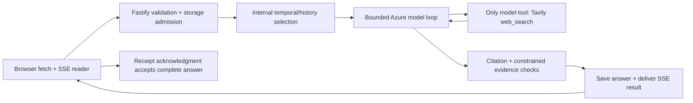

# Minimi Recall Agent v2.1

A local TypeScript research assistant with persistent conversations, deterministic
date-based recall, real source registries and conservative historical comparisons.
Fastify serves a plain JavaScript browser UI. The only external model tool is
`web_search` (Tavily); memory/date loading and validation are internal functions.
No database server, embeddings, Docker or frontend build is required.

## Windows quick start

Use Node.js 24 LTS and npm (audit environment: Node 24.14.1, npm 11.21.2).
From the repository directory in PowerShell:

```powershell
npm.cmd install
Copy-Item .env.example .env # First setup only; do not overwrite existing settings.
# Edit .env locally, using the configuration below.
npm.cmd run dev
```

Open `http://127.0.0.1:3000`; `GET /health` checks server health without provider
calls. `npm.cmd start` runs without watch mode. There is no `build` script:
`tsx` runs TypeScript directly and the browser assets are already plain JS/CSS.
On other shells, use `npm` in place of `npm.cmd`.

The template defaults to a reserved provider for credential-free server startup.
For working HTTP chat, change/add **all** of these settings in `.env`:

```dotenv
MODEL_PROVIDER=azure-openai-v1
AZURE_OPENAI_CHAT_ENDPOINT=https://YOUR-RESOURCE.openai.azure.com/openai/v1/chat/completions
AZURE_OPENAI_DEPLOYMENT=YOUR-DEPLOYMENT
AZURE_OPENAI_API_KEY=YOUR-KEY
AZURE_OPENAI_CONTEXT_TOKENS=YOUR-ACTUAL-CONTEXT-WINDOW
TAVILY_API_KEY=YOUR-KEY
HOST=127.0.0.1
DEFAULT_TIMEZONE=Asia/Kolkata
```

Deployment identity and tool/max_completion_tokens compatibility must be checked
in Azure; MODEL_NAME does not select the Azure deployment. Both Azure and Tavily
configuration are required even for recall-only HTTP chat. Unsupported/missing
chat configuration returns sanitized HTTP 503; selecting Azure with incomplete
settings instead fails startup validation with the missing field names. Invalid
keys may fail only when used. Never share `.env`, enable billing or assume free
quota: confirm sponsorship eligibility, balances and overage settings first.
Port, log level and request-size options are listed in `.env.example`.

## Verification without paid calls

```powershell
npm.cmd run typecheck
npm.cmd test
npm.cmd run eval:offline
git diff --check
```

The committed offline run records **597 tests passed, one skipped**, with **28/28
structural/safety checks and 25/28 usefulness checks**. These are scripted-provider
outcomes, not live LLM accuracy. The evaluation command rewrites
`docs/evaluation-results.json` with local observations; timings/IDs vary by run.
See [evaluation methodology and failures](docs/evaluation.md). Do not run
`smoke:tavily` without separate live-call/cost authorization.

## Request flow and limits



SSE delivers factual progress and one final/partial answer. **Token streaming is
not implemented.** Budgets: 25 seconds overall, 10 seconds/model call, 4 seconds/
search, search admission cutoff 15 seconds; at most three model calls and two
research rounds with 5+3 searches, concurrency two. Disconnects cancel work.
See [wire contract](docs/chat-sse.md) and [agent core](docs/agent-core.md).

Original UTC messages and source snapshots live in private, gitignored
`.recall-data/` under the launch directory. Only one process may own that store.
Refresh/restart restoration uses server records; the browser keeps minimal identity.
Receipt recovery does not repeat provider calls. Failed, partial and unaccepted
answers are excluded from accepted historical answers. JSON files are plaintext,
not encrypted. The UI has no delete control. Delete a conversation through the
local API using its UUID (listed by `GET /api/conversations`):

```powershell
# Replace YOUR-CONVERSATION-UUID with the intended conversation's ID.
Invoke-RestMethod -Method Delete -Uri 'http://127.0.0.1:3000/api/conversations/YOUR-CONVERSATION-UUID'
```

Deletion refuses pending attempts; resolve them through the documented receipt
API first (complete answers also have a Recover / retry receipt action). Failed
or corrupt storage requires manual recovery as described in docs/memory.md.
Starting a new conversation or clearing browser data does not delete server files.
Keep private data out
of submissions/backups shared with reviewers. This loopback-only app has no public
deployment authentication. See [storage/recall limits](docs/memory.md).

Citation IDs establish registry membership, not factual truth. Historical S1 and
current S1 remain separate. Four verdicts are retained: Confirmed change, No
confirmed change, Cannot verify, Not comparable. Confirmation currently requires
the [strict evidence grammar and explicit authority policy](docs/verification.md).
Natural-language pricing often produces restrictive abstentions. Quote matching
uses model-visible snippets and does not prove complete claim support.

## Five-minute reviewer demonstration

1. Run `npm.cmd run eval:offline`: W1 shows scripted research/SSE/citations;
   R1–R6 show restarted cross-conversation/date/zone retrieval; C1–C5 show four
   comparison outcomes; C6–C11 expose abstentions. These are frozen synthetic
   demonstrations, explicitly **not genuine live research**.
2. Inspect `docs/evaluation-results.json` for actual output, provider call counts,
   and the distinction between safety and usefulness.
3. With separately authorized quotas only: ask for the latest PostgreSQL release
   from official announcements. Check current sources and their dates manually.
4. Record a distinctive five-product CRM shortlist, wait for accepted delivery,
   restart, and recall it in a new conversation using its actual date/timezone.
   Check telemetry confirms zero Tavily calls for pure recall.
5. Recheck a genuinely stored recommendation against fresh evidence. Do not seed
   fictional historical prices. Show honest Cannot verify when the baseline or
   comparable evidence is missing. No automatic retries during a capped pilot.

Before final acceptance, manually check desktop/mobile Chrome: refresh/restoration,
older conversation reopening, source links/disclosure and reader position, long
answers above the composer, sticky scroll versus reading upward, cancellation,
older-turn retry ordering, and offline/error recovery. Real-browser geometry,
fresh-machine install and the controlled live pilot are not verified by this README.
