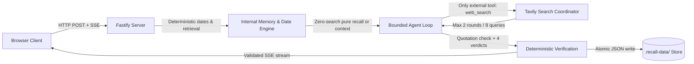

# Minimi Recall Agent v2.1

A fast, historically aware, evidence-grounded research assistant built for the Minimi hiring challenge:
> *"Build the best chat agent you can with one tool, web search. It should answer fast, get things right, and remember what you asked and when."*

The application runs locally on Node.js with TypeScript and Fastify, serving a lightweight browser interface in plain JavaScript, HTML, and CSS. The language model is given **exactly one external tool: `web_search`** (powered by Tavily). Temporal date resolution, cross-conversation memory retrieval, quotation verification, and JSON persistence are implemented as deterministic internal functions, not model tools. No vector database, external server, embeddings, Docker, or frontend build step is required.

---

## 1. Prerequisites and Installation

### Prerequisites
- **Node.js:** Node 24 LTS (verified on Node 24.14.1, npm 11.21.2).
- **OS:** Windows (PowerShell), macOS, or Linux.
- **API Credentials (for live chat):**
  - An Azure OpenAI v1 Chat Completions endpoint with a deployed model supporting tool calling and system messages.
  - A Tavily Search API key (free tier available at [tavily.com](https://tavily.com)).

### Quick Start (Windows PowerShell)

```powershell
# 1. Install dependencies
npm.cmd install

# 2. Set up environment configuration (first run only)
Copy-Item .env.example .env

# 3. Edit .env with your credentials (see Configuration below)

# 4. Start the development server
npm.cmd run dev
```

### Quick Start (macOS / Linux / Bash)

```bash
# 1. Install dependencies
npm install

# 2. Set up environment configuration
cp .env.example .env

# 3. Edit .env with your credentials

# 4. Start the development server
npm run dev
```

Open [http://127.0.0.1:3000](http://127.0.0.1:3000) in your browser. `GET /health` checks service availability without making any provider calls. `npm run start` launches the server without file watching.

*(Note: There is no frontend compilation step. `tsx` executes backend TypeScript directly, and frontend assets are native vanilla JavaScript and CSS.)*

---

## 2. Environment Configuration

Copy `.env.example` to `.env`. For active chat execution, provide valid configuration values:

```dotenv
# Server Settings
HOST=127.0.0.1
PORT=3000
NODE_ENV=development
DEFAULT_TIMEZONE=Asia/Kolkata

# Model Provider: Azure OpenAI v1 Chat Completions
MODEL_PROVIDER=azure-openai-v1
AZURE_OPENAI_CHAT_ENDPOINT=https://YOUR-RESOURCE.openai.azure.com/openai/v1/chat/completions
AZURE_OPENAI_DEPLOYMENT=YOUR-DEPLOYMENT-NAME
AZURE_OPENAI_API_KEY=YOUR-AZURE-KEY
AZURE_OPENAI_CONTEXT_TOKENS=65536

# Search Provider: Tavily API
TAVILY_API_KEY=YOUR-TAVILY-KEY
```

### Where to Obtain Credentials Safely
- **Azure OpenAI:** In the [Azure Portal](https://portal.azure.com/), locate your Azure OpenAI Service resource. Navigate to **Keys and Endpoint** for the endpoint URL and API key, and **Model Deployments** to deploy a compatible chat model (e.g. `gpt-4o` or `gpt-4o-mini`). Confirm support for function calling and `max_completion_tokens`.
- **Tavily:** Create a free account at [app.tavily.com](https://app.tavily.com) and generate an API key from the dashboard.
- **Safety & Costs:** Always check free-tier quota balances, student sponsorships, and overage policies before use. Never commit `.env` or expose API keys in public repositories.

---

## 3. Architecture and Request Flow



- **One Tool Loop:** The model's only external tool is `web_search`. Memory retrieval and temporal date calculations run deterministically before the model is called.
- **Strict Budgeting:** Overall request deadline of 25 seconds; search admission cutoff at 15 seconds; model call timeout of 10 seconds; search query timeout of 4 seconds. Capped at 2 search rounds (up to 5 queries in round 1, up to 3 additional in round 2; 8 total).
- **Streaming & SSE:** Delivers factual progress indicators followed by a validated final answer via Server-Sent Events (`recall.chat.v1`). Client socket disconnects immediately abort pending provider requests.

---

## 4. Verification and Automated Evaluations

Run the complete suite without making live API calls or consuming credits:

```powershell
# 1. Type check server and client code
npm.cmd run typecheck

# 2. Run automated test suite
npm.cmd test

# 3. Run the frozen 31-case offline evaluation suite
npm.cmd run eval:offline

# 4. Run the 10 adversarial capability scenarios
npx vitest run tests/adversarial-eval.test.ts
```

### Verified Benchmark Metrics
- **Automated Regression Suite:** **791 tests passed, 1 skipped** across 23 test files.
- **Scripted Offline Evaluation (`eval:offline`):**
  - **31 / 31 (100%)** structural and safety assertions passed.
  - **30 / 31 (96.8%)** usefulness assertions passed.
  - 1 documented restrictive abstention: Case C8 withholds trust because the synthetic domain (`acme.example`) is outside the explicit official product authority whitelist.
- **Adversarial Capability Scenarios (`tests/adversarial-eval.test.ts`):**
  - **10 / 10 (100%)** passed across paraphrased recall, weekday isolation, mixed shortlist research, PostgreSQL comparison, hypothetical rejection, chronological cancellation, quotation mismatch warning, search outage fallback, long-history token budgeting, and multi-turn threads.

*(Note: Scripted and mocked offline tests measure internal application logic, temporal arithmetic, and contract enforcement. They do not measure live third-party LLM accuracy or live network latency.)*

---

## 5. Demonstration Conversations

### Scenario A: Pure Historical Recall (Zero Search Calls)
- **Turn 1 (Conversation A):**
  *User:* “We selected ClickHouse for telemetry analytics after comparing alternatives.”
  *Agent:* Confirms selection and records turn.
- **Turn 2 (New Conversation B):**
  *User:* “Which telemetry analytics did we discuss earlier?”
  *Agent:* “You previously selected ClickHouse for telemetry analytics.”
  *(Execution: Retrievable immediately from disk memory with **0 external search calls**.)*

### Scenario B: Shortlist Recall + Fresh Web Research (Mixed Query)
- **Turn 1 (Past Session):**
  *User:* “On Monday we shortlisted five CRM tools: Attio, Folk, Capsule, Insightly, Copper.”
  *Agent:* Records the 5 shortlisted entities.
- **Turn 2 (Current Session):**
  *User:* “Which five CRM tools did we shortlist last Monday? What is Attio current entry price?”
  *Agent:* “You previously shortlisted Attio, Folk, Capsule, Insightly, and Copper. Fresh research shows Attio Starter is USD 29 per user per month [S1].”
  *(Execution: Internal memory extracts the 5 tools; agent conducts 1 targeted web search for Attio pricing and cites [S1].)*

### Scenario C: Historical Change Verification
- **Turn 1 (Recorded earlier):** User previously inquired about Supabase Postgres hosting ($25/mo recorded with source).
- **Turn 2 (Today):**
  *User:* “On 25 October I asked about Supabase Postgres pricing. Has any pricing changed since then?”
  *Agent:* Emits candidate comparison. The deterministic verification engine compares like-for-like dimensions, validates `supabase.com` against the domain authority whitelist, detects the price increase ($25 &rarr; $35), and outputs:
  `1. Confirmed change — supabase: Explicit comparable evidence records a price increase.` citing `[S1]`.

---

## 6. Local JSON Storage vs. Public Multi-User Hosting

- **Local Storage Model:** Conversations and source evidence snapshots are stored in private JSON files inside `.recall-data/` under the application root. File integrity is maintained using per-conversation write queues, unique temporary files, and atomic file renaming.
- **Single-Process Design:** Designed for local single-process evaluation as required by the challenge. It is not architected for distributed cloud clustering or shared filesystem concurrency.
- **Local Loopback Security:** The server binds to `127.0.0.1` by default and enforces local origin guards. There is no public user authentication or database encryption layer. Do not expose this local port to untrusted public networks.
- **Challenge Compliance:** Public cloud deployment is neither required nor requested by the challenge specification. The agent is built to run cleanly on any reviewer's machine with `npm install` followed by `npm run dev`.

---

## 7. Project Documentation Index

- [DESIGN.md](DESIGN.md) — Comprehensive architectural design, trade-offs, and verification logic.
- [docs/memory.md](docs/memory.md) — Persistent storage schema, receipts, and temporal retrieval contracts.
- [docs/verification.md](docs/verification.md) — Quotation matching, four verification verdicts, and authority policies.
- [docs/chat-sse.md](docs/chat-sse.md) — SSE wire protocol and event sequence specification.
- [docs/evaluation.md](docs/evaluation.md) — Detailed offline evaluation methodology and case breakdown.
